<p align="center"></p>

<p align="center">
<a href="THEMEN.md"><b>Themen durchsuchen</b></a> ·
<a href="index.md">Alle Seiten</a> ·
<a href="START.md">In Obsidian öffnen</a>
</p>

<p align="center">


<a href="NUTZUNG.md"></a>
</p>

**891 Seiten aus meinen gespeicherten X-Posts, als Wiki.** Zusammenfassungen, Seiten zu einzelnen Tools und Methoden, und bei jeder Aussage der Link zur Originalquelle. Der Schwerpunkt liegt auf KI-Agenten und Tools; dazu kommen Produktentwicklung, Marketing, Forschung und Trading. Lies es hier auf GitHub oder öffne es als Vault in Obsidian.

## So prüfst du eine Aussage

<p align="center"></p>

## Womit du anfangen kannst

<table>
<tr>
<td width="33%" valign="top">

### 🤖 Coding-Agenten
Welche Rolle Claude Code übernimmt und welche Arbeitsweisen unter Agentic Engineering gesammelt sind.

[Claude Code](entities/Claude%20Code.md)<br>
[Agentic Engineering](concepts/Agentic%20Engineering.md)

</td>
<td width="33%" valign="top">

### 🧠 Kontext & Gedächtnis
Kontextverwaltung und ein Wiki als Gedächtnis für Agenten.

[Context Engineering](concepts/Context%20Engineering.md)<br>
[LLM Wiki Pattern](concepts/LLM%20Wiki%20Pattern.md)

</td>
<td width="33%" valign="top">

### 🎨 Produkte gestalten
Designvorgaben und Skills für Gestaltungsaufgaben mit KI.

[Design Markdown](entities/Design%20Markdown.md)<br>
[Design Skills for Coding Agents](concepts/Design%20Skills%20for%20Coding%20Agents.md)

</td>
</tr>
<tr>
<td width="33%" valign="top">

### 📣 Marketing
Eine Taktikensammlung und die Aufgaben, die Marketing-Skills abdecken.

[Vibe Marketing Tactics](concepts/Vibe%20Marketing%20Tactics.md)<br>
[Aaron Marketing Skills](entities/Aaron%20Marketing%20Skills.md)

</td>
<td width="33%" valign="top">

### 📚 Lesestoff
Bücher zu KI und Data Science mit den zugehörigen Quellen.

[AI and Data Science Reading List](synthesis/AI%20and%20Data%20Science%20Reading%20List.md)

</td>
<td width="33%" valign="top">

### 🧭 Mehr entdecken
Trading, Krypto, Sicherheit, Forschung und LLM-Training.

[**Alle Themen →**](THEMEN.md)<br>
[Alle Seiten](index.md)

</td>
</tr>
</table>

## Neu im Brain

Die zuletzt angelegten Seiten (Stand 2026-10-28):

| Seite | Worum es geht |
|---|---|
| 🧩 [WebMCP](entities/WebMCP.md) | Laut dem Chrome-Entwicklerkonto ersetzt WebMCP das MCP nicht. |
| 🧩 [OpenDuet](entities/OpenDuet.md) | OpenDuet ist eine Open-Source-Vorlage von CopilotKit für einen proaktiven KI-Agenten, der selbst gehostet wird. |
| 🧩 [Open Code Review](entities/Open%20Code%20Review.md) | Open Code Review ist ein quelloffenes CLI-Tool für KI-gestützte Code-Reviews. |
| 🧩 [Hermit](entities/Hermit.md) | Hermit ist ein Open-Source-Framework der Infini-AI-Lab für Continual Learning und RSI durch Harness-Adapter-Evolution. |
| 🧩 [DeepTutor](entities/DeepTutor.md) | DeepTutor ist ein quelloffener KI-Tutor der HKU (HKUDS) und läuft laut Post als Arbeitsbereich für Erklären, Üben, Tiefenrecherche. |

## Was die Sammlung abdeckt

<p align="center"></p>

<p align="center">
<a href="index.md#entitäten">Tools und Personen</a> ·
<a href="index.md#konzepte">Konzepte</a> ·
<a href="index.md#synthesen">Zusammenstellungen</a> ·
<a href="index.md#quellen">Quellen</a>
</p>

<p align="center"></p>

## Lokal lesen

<p align="center"></p>

- Lies das Wiki auf GitHub oder öffne den heruntergeladenen Ordner in Obsidian als Vault. Zusätzliche Plugins brauchst du nicht. [Anleitung](START.md)
- Die Seiten enthalten Zusammenfassungen und Originallinks. Angaben können veraltet sein; vollständige Fremdtexte und Originalmedien sind nicht enthalten. [Quellenstand](AKTUALITAET.md)
- Updates holst du mit `git pull --ff-only` oder einem neuen ZIP. Sichere eigene Notizen vorher separat.
- Es gilt keine pauschale offene Lizenz. [Nutzung und Rechte](NUTZUNG.md)

<details>
<summary><b>🤖 Lieber den Coding-Agenten machen lassen?</b> Auftrag zum Kopieren</summary>

> [!TIP]
> Kopiere diesen Auftrag in deinen Coding-Agenten:
>
> ```text
> Hole https://github.com/guschi18/x-bookmarks-brain auf meinen PC.
> Klone das Repository in einen neuen Ordner namens x-bookmarks-brain
> in meinem Benutzerordner. Falls der Name schon existiert, wähle einen
> freien Namen und überschreibe nichts.
> Falls Git fehlt, lade stattdessen das ZIP herunter und entpacke es dort.
> Installiere keine zusätzlichen Programme. Wenn der Zugriff scheitert,
> melde es mir.
> Nenne mir anschließend den vollständigen Ordnerpfad und erkläre kurz,
> wie ich diesen Ordner in Obsidian als Vault öffne.
> ```

</details>


<p align="center">
<b>Neugierig geworden?</b><br>
<a href="THEMEN.md">Themen durchsuchen</a> ·
<a href="index.md">Alle 891 Seiten</a> ·
<a href="START.md">Obsidian-Anleitung</a> ·
<a href="NUTZUNG.md">Nutzung &amp; Rechte</a>
</p>
