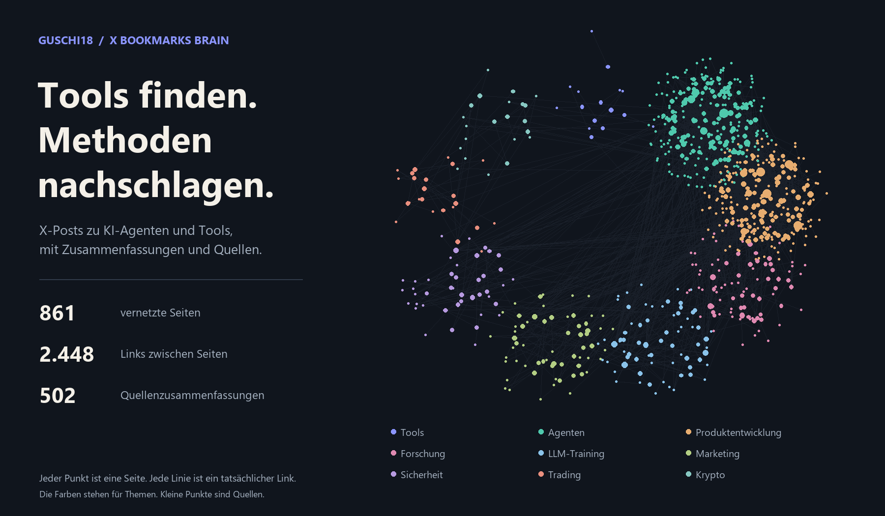

# X Bookmarks Brain

Finde Tools und Methoden für deine Arbeit mit KI-Agenten.

Hier findest du meine gespeicherten X-Posts als Wiki: mit Zusammenfassungen, Seiten zu einzelnen Tools und Methoden sowie Links zu den Originalquellen. Du kannst ein Thema nachschlagen, verwandte Werkzeuge entdecken und bei einer Aussage nachlesen, worauf sie sich stützt.

Die meisten Seiten beschäftigen sich mit KI-Agenten und Tools. Daneben sammle ich Beiträge zu Produktentwicklung, Marketing, Forschung, Trading und weiteren Interessen. Du kannst die Sammlung hier auf GitHub lesen oder als Vault in Obsidian öffnen.

[Themen durchsuchen](THEMEN.md) · [Alle Seiten](index.md) · [In Obsidian öffnen](START.md)

## Womit du anfangen kannst

### Coding-Agenten einsetzen

Lies nach, welche Rolle Claude Code übernimmt und welche Arbeitsweisen unter Agentic Engineering gesammelt sind.

[Claude Code](entities/Claude%20Code.md) · [Agentic Engineering](concepts/Agentic%20Engineering.md)

### Kontext und Wissen für Agenten organisieren

Hier findest du Ansätze für Kontextverwaltung und ein Wiki als Gedächtnis für Agenten.

[Context Engineering](concepts/Context%20Engineering.md) · [LLM Wiki Pattern](concepts/LLM%20Wiki%20Pattern.md)

### Mit KI Produkte gestalten

Diese Seiten behandeln Designvorgaben und Skills für Gestaltungsaufgaben.

[Design Markdown](entities/Design%20Markdown.md) · [Design Skills for Coding Agents](concepts/Design%20Skills%20for%20Coding%20Agents.md)

### Marketing-Ideen nachschlagen

Stöbere in einer Taktikensammlung und sieh dir an, welche Aufgaben Marketing-Skills abdecken.

[Vibe Marketing Tactics](concepts/Vibe%20Marketing%20Tactics.md) · [Aaron Marketing Skills](entities/Aaron%20Marketing%20Skills.md)

### Lesestoff zu KI und Data Science finden

Die Leseliste führt zu Büchern und den zugehörigen Quellen.

[AI and Data Science Reading List](synthesis/AI%20and%20Data%20Science%20Reading%20List.md)

## Was die Sammlung abdeckt

Eine Seite kann mehrere Themen haben. Die Grafik zählt die Seiten über Tools, Konzepte und Zusammenstellungen; die separaten Quellenzusammenfassungen kommen hinzu.

| Hier kannst du nachschlagen | Inhalt | Seiten |
| --- | --- | ---: |
| [Tools und Personen](index.md#entitäten) | Auch Produkte und Organisationen | 278 |
| [Konzepte und Methoden](index.md#konzepte) | Erklärungen und Arbeitsweisen | 75 |
| [Leselisten und Zusammenstellungen](index.md#synthesen) | Beiträge zu einem gemeinsamen Thema | 6 |
| [Quellen](index.md#quellen) | Zusammenfassungen mit Originallinks | 502 |

Insgesamt 861 Inhaltsseiten. Die zuletzt gepflegte Seite hat den Stand 2026-10-25.

## Eine Aussage bis zur Quelle verfolgen

Auf den Wissensseiten führen Quellenlinks zur jeweiligen Zusammenfassung. Dort findest du den Autor, den Originalpost und Links zu gespeicherten Artikeln, soweit vorhanden. So kannst du prüfen, ob ein Tipp zu deinem Vorhaben passt und ob der Originaltext deine Frage beantwortet.

Die Auswahl ist persönlich. Herstellerangaben und Erfahrungsberichte sind keine unabhängigen Tests. Preise, Versionen und andere Angaben können veraltet sein; das Pflegedatum einer Seite bestätigt nicht jede Aussage erneut. Hinweise dazu stehen unter [Aktualität und Quellen](AKTUALITAET.md).

## Das Wiki in Obsidian nutzen

Lade das Repository herunter und öffne den Ordner als Vault. Du kannst dann die Volltextsuche, Rückverweise und den Graphen von Obsidian verwenden. Zusätzliche Plugins oder API-Schlüssel brauchst du zum Lesen nicht. Die [Schritt-für-Schritt-Anleitung](START.md) führt dich durch den Download.

Die Seiten verwenden relative Markdown-Links und lassen sich auch direkt auf GitHub lesen.

## Aktuell bleiben

Ich pflege die Sammlung weiter. Neue Stände ergänzen und überarbeiten Seiten; dabei können Seiten auch umbenannt werden oder entfallen. Die Commit-Historie auf GitHub zeigt dir die Änderungen.

Bei einem Clone holt `git pull --ff-only` den neuesten Stand. Ein ZIP aktualisiert sich nicht selbst: Lade bei Bedarf eine neue Ausgabe herunter. Halte eigene Notizen separat oder sichere sie vor einem Update, damit sie nicht mit Änderungen dieser Sammlung kollidieren.

## Welche Inhalte mitgeliefert werden

Die Quellenseiten enthalten Zusammenfassungen und Links. Vollständige gespeicherte Fremdtexte, Transkripte und Originalbilder gehören nicht zu dieser Ausgabe. Wenn eine Seite auf einen vollständigen Wortlaut im Archiv verweist, folge für diese Ausgabe dem Originallink.

Für die Sammlung ist derzeit keine pauschale offene Lizenz vergeben. Einzelheiten stehen unter [Nutzung und Rechte](NUTZUNG.md).
