<p align="center"></p>

<p align="center">
<a href="THEMEN.md"><b>Themen durchsuchen</b></a> ·
<a href="index.md">Alle Seiten</a> ·
<a href="START.md">In Obsidian öffnen</a>
</p>

Hier findest du meine gespeicherten X-Posts als Wiki: mit Zusammenfassungen, Seiten zu einzelnen Tools und Methoden sowie Links zu den Originalquellen. Du kannst ein Thema nachschlagen, verwandte Werkzeuge entdecken und bei einer Aussage nachlesen, worauf sie sich stützt.

Die meisten Seiten beschäftigen sich mit KI-Agenten und Tools. Daneben sammle ich Beiträge zu Produktentwicklung, Marketing, Forschung, Trading und weiteren Interessen. Du kannst die Sammlung hier auf GitHub lesen oder als Vault in Obsidian öffnen.

## Womit du anfangen kannst

### Coding-Agenten einsetzen

Lies nach, welche Rolle Claude Code übernimmt und welche Arbeitsweisen unter Agentic Engineering gesammelt sind.

[Claude Code](entities/Claude%20Code.md) · [Agentic Engineering](concepts/Agentic%20Engineering.md)

### Kontext und Wissen für Agenten organisieren

Hier findest du Ansätze für Kontextverwaltung und ein Wiki als Gedächtnis für Agenten.

[Context Engineering](concepts/Context%20Engineering.md) · [LLM Wiki Pattern](concepts/LLM%20Wiki%20Pattern.md)

### Mit KI Produkte gestalten

Diese Seiten behandeln Designvorgaben und Skills für Gestaltungsaufgaben.

[Design Markdown](entities/Design%20Markdown.md) · [Design Skills for Coding Agents](concepts/Design%20Skills%20for%20Coding%20Agents.md)

### Marketing-Ideen nachschlagen

Stöbere in einer Taktikensammlung und sieh dir an, welche Aufgaben Marketing-Skills abdecken.

[Vibe Marketing Tactics](concepts/Vibe%20Marketing%20Tactics.md) · [Aaron Marketing Skills](entities/Aaron%20Marketing%20Skills.md)

### Lesestoff zu KI und Data Science finden

Die Leseliste führt zu Büchern und den zugehörigen Quellen.

[AI and Data Science Reading List](synthesis/AI%20and%20Data%20Science%20Reading%20List.md)

## Was die Sammlung abdeckt


Eine Seite kann mehrere Themen haben. Die Grafik zählt die Seiten über Tools, Konzepte und Zusammenstellungen; die separaten Quellenzusammenfassungen kommen hinzu.

| Hier kannst du nachschlagen | Inhalt | Seiten |
| --- | --- | ---: |
| [Tools und Personen](index.md#entitäten) | Auch Produkte und Organisationen | 287 |
| [Konzepte und Methoden](index.md#konzepte) | Erklärungen und Arbeitsweisen | 79 |
| [Leselisten und Zusammenstellungen](index.md#synthesen) | Beiträge zu einem gemeinsamen Thema | 5 |
| [Quellen](index.md#quellen) | Zusammenfassungen mit Originallinks | 520 |

Insgesamt 891 Inhaltsseiten. Die zuletzt gepflegte Seite hat den Stand 2026-10-29.

## Kurz zur Nutzung

- Lies das Wiki auf GitHub oder öffne den heruntergeladenen Ordner in Obsidian als Vault. Zusätzliche Plugins brauchst du nicht. [Anleitung](START.md)
- Die Seiten enthalten Zusammenfassungen und Originallinks. Angaben können veraltet sein; vollständige Fremdtexte und Originalmedien sind nicht enthalten. [Quellenstand](AKTUALITAET.md)
- Updates holst du mit `git pull --ff-only` oder einem neuen ZIP. Sichere eigene Notizen vorher separat.
- Es gilt keine pauschale offene Lizenz. [Nutzung und Rechte](NUTZUNG.md)

## Mit einem KI-Agenten auf deinen PC holen

> [!TIP]
> Kopiere diesen Auftrag in deinen Coding-Agenten:
>
> ```text
> Hole https://github.com/guschi18/x-bookmarks-brain auf meinen PC.
> Klone das Repository in einen neuen Ordner namens x-bookmarks-brain
> in meinem Benutzerordner. Falls der Name schon existiert, wähle einen
> freien Namen und überschreibe nichts.
> Falls Git fehlt, lade stattdessen das ZIP herunter und entpacke es dort.
> Installiere keine zusätzlichen Programme. Wenn der Zugriff scheitert,
> melde es mir.
> Nenne mir anschließend den vollständigen Ordnerpfad und erkläre kurz,
> wie ich diesen Ordner in Obsidian als Vault öffne.
> ```
