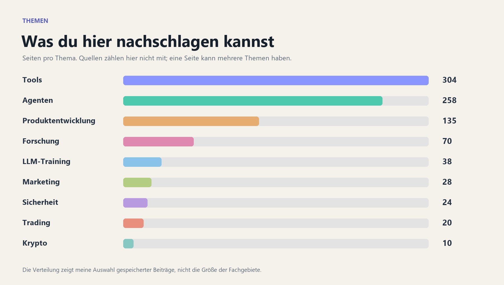

# Themen durchsuchen

[Start](README.md) · [Alle Seiten](index.md)

Wähle ein Thema und öffne eine Seite, die dich interessiert. Manche Seiten erscheinen in mehreren Abschnitten, weil sie mehrere Themen behandeln.

## Tools

304 Wissensseiten · Tag `tools`

- [1k Papers](entities/1k%20Papers.md)
- [21st.dev](entities/21st.dev.md)
- [Aaron Marketing Skills](entities/Aaron%20Marketing%20Skills.md)
- [Academic Research Skills](entities/Academic%20Research%20Skills.md)
- [Adaptive Reasoning Effort](concepts/Adaptive%20Reasoning%20Effort.md)
- [Addy Osmani Agent Skills](entities/Addy%20Osmani%20Agent%20Skills.md)
- [Adler AI](entities/Adler%20AI.md)
- [Agency](entities/Agency.md)
- [Agent Orchestrator](entities/Agent%20Orchestrator.md)
- [Agent Reach](entities/Agent%20Reach.md)
- [Agent Scripts](entities/Agent%20Scripts.md)
- [Agent Workflow Graphs](concepts/Agent%20Workflow%20Graphs.md)
- [Agentic Inbox](entities/Agentic%20Inbox.md)
- [Agentic Video Production](concepts/Agentic%20Video%20Production.md)
- [Agentloop](entities/Agentloop.md)
- [Agentlytics](entities/Agentlytics.md)
- [AgentRun](entities/AgentRun.md)
- [AI Agency Tool Stack](concepts/AI%20Agency%20Tool%20Stack.md)
- [AI Agents in Depth](entities/AI%20Agents%20in%20Depth.md)
- [AI Coding Cost Claims](concepts/AI%20Coding%20Cost%20Claims.md)
- [AI Coding Dictionary](entities/AI%20Coding%20Dictionary.md)
- [AI Engineering and Design Accounts](synthesis/AI%20Engineering%20and%20Design%20Accounts.md)
- [AI Learning Accounts](synthesis/AI%20Learning%20Accounts.md)
- [AI Website Cloner Template](entities/AI%20Website%20Cloner%20Template.md)
- [Amicro](entities/Amicro.md)
- [Answer Me With HTML](entities/Answer%20Me%20With%20HTML.md)
- [Ant Apply](entities/Ant%20Apply.md)
- [App Store Connect CLI](entities/App%20Store%20Connect%20CLI.md)
- [Archify](entities/Archify.md)
- [Astra Agent Instructions](entities/Astra%20Agent%20Instructions.md)
- [Atomic Bot](entities/Atomic%20Bot.md)
- [Autobrowse](entities/Autobrowse.md)
- [AutoHarness](entities/AutoHarness.md)
- [Awesome CAN Bus](entities/Awesome%20CAN%20Bus.md)
- [Awesome Claude](entities/Awesome%20Claude.md)
- [Awesome Finance MCP](entities/Awesome%20Finance%20MCP.md)
- [Awesome Trading Agents](entities/Awesome%20Trading%20Agents.md)
- [Backpass](entities/Backpass.md)
- [Baguette](entities/Baguette.md)
- [BAND](entities/BAND.md)
- [Bb](entities/Bb.md)
- [Beacon](entities/Beacon.md)
- [Bluey](entities/Bluey.md)
- [Book to Skill](entities/Book%20to%20Skill.md)
- [Browser Use](entities/Browser%20Use.md)
- [Building With Jev Skill](entities/Building%20With%20Jev%20Skill.md)
- [Cabinet](entities/Cabinet.md)
- [CAN Bus Reverse Engineering](concepts/CAN%20Bus%20Reverse%20Engineering.md)
- [Capafy](entities/Capafy.md)
- [CashClaw](entities/CashClaw.md)
- [CheckMyGit](entities/CheckMyGit.md)
- [Chops](entities/Chops.md)
- [Chrome DevTools MCP](entities/Chrome%20DevTools%20MCP.md)
- [Cinetic](entities/Cinetic.md)
- [Claude API Skill](entities/Claude%20API%20Skill.md)
- [Claude Code](entities/Claude%20Code.md)
- [Claude Code Best Practice](entities/Claude%20Code%20Best%20Practice.md)
- [Claude Code CLI Training](entities/Claude%20Code%20CLI%20Training.md)
- [Claude Code Mods](entities/Claude%20Code%20Mods.md)
- [Claude Code Security Hardening](concepts/Claude%20Code%20Security%20Hardening.md)
- [Claude Code Video Toolkit](entities/Claude%20Code%20Video%20Toolkit.md)
- [Claude Cowork](entities/Claude%20Cowork.md)
- [Claude Design](entities/Claude%20Design.md)
- [Claude for Financial Services](entities/Claude%20for%20Financial%20Services.md)
- [Claude Image View](entities/Claude%20Image%20View.md)
- [Claude Managed Agents](entities/Claude%20Managed%20Agents.md)
- [Claude Obsidian](entities/Claude%20Obsidian.md)
- [Claude Opus 5.5](entities/Claude%20Opus%205.5.md)
- [Claude Plugins](entities/Claude%20Plugins.md)
- [Claude Projects](entities/Claude%20Projects.md)
- [Claude Skills Guide](concepts/Claude%20Skills%20Guide.md)
- [Claude Sonnet 5.5](entities/Claude%20Sonnet%205.5.md)
- [Claude Tag](entities/Claude%20Tag.md)
- [Claude Use Cases](entities/Claude%20Use%20Cases.md)
- [Cloudflare Security Audit Skill](entities/Cloudflare%20Security%20Audit%20Skill.md)
- [CMP Unlocker](entities/CMP%20Unlocker.md)
- [Cmux](entities/Cmux.md)
- [Codebase Memory MCP](entities/Codebase%20Memory%20MCP.md)
- [CodeBurn](entities/CodeBurn.md)
- [CodeFlow](entities/CodeFlow.md)
- [CodeWiki](entities/CodeWiki.md)
- [Codex](entities/Codex.md)
- [Codex Astra Luna Orchestrator](entities/Codex%20Astra%20Luna%20Orchestrator.md)
- [Codex Plugin for Claude Code](entities/Codex%20Plugin%20for%20Claude%20Code.md)
- [Component Gallery](entities/Component%20Gallery.md)
- [Context Engineering](concepts/Context%20Engineering.md)
- [Dash](entities/Dash.md)
- [David Ondrej Skills](entities/David%20Ondrej%20Skills.md)
- [DaVinci Resolve](entities/DaVinci%20Resolve.md)
- [Deepsec](entities/Deepsec.md)
- [DeepTutor](entities/DeepTutor.md)
- [DeerFlow](entities/DeerFlow.md)
- [Dembrandt](entities/Dembrandt.md)
- [Design Engineer Tools](entities/Design%20Engineer%20Tools.md)
- [Design Markdown](entities/Design%20Markdown.md)
- [Design Skills for Coding Agents](concepts/Design%20Skills%20for%20Coding%20Agents.md)
- [Diagram Design](entities/Diagram%20Design.md)
- [Diffusion Studio](entities/Diffusion%20Studio.md)
- [Dokobot](entities/Dokobot.md)
- [Earshot](entities/Earshot.md)
- [Elaya Design Skills](entities/Elaya%20Design%20Skills.md)
- [Emil Kowalski Skills](entities/Emil%20Kowalski%20Skills.md)
- [Everything Claude Code](entities/Everything%20Claude%20Code.md)
- [Exercises Dataset](entities/Exercises%20Dataset.md)
- [Explain Skill](entities/Explain%20Skill.md)
- [Factory AI](entities/Factory%20AI.md)
- [Fan-Out Refactor Review](concepts/Fan-Out%20Refactor%20Review.md)
- [Fast Flights](entities/Fast%20Flights.md)
- [FilmCraft](entities/FilmCraft.md)
- [Financial Datasets](entities/Financial%20Datasets.md)
- [Financial Research Directory](concepts/Financial%20Research%20Directory.md)
- [Fincept Terminal](entities/Fincept%20Terminal.md)
- [FinSkills](entities/FinSkills.md)
- [Flowsint](entities/Flowsint.md)
- [Free Ebook Resources](synthesis/Free%20Ebook%20Resources.md)
- [FreeToken](entities/FreeToken.md)
- [Gemini Embedding 2](entities/Gemini%20Embedding%202.md)
- [GEO SEO](entities/GEO%20SEO.md)
- [Google ADK](entities/Google%20ADK.md)
- [Google Agents CLI](entities/Google%20Agents%20CLI.md)
- [Google AI Studio](entities/Google%20AI%20Studio.md)
- [Google Colab VS Code](entities/Google%20Colab%20VS%20Code.md)
- [Google Maps Scrapper](entities/Google%20Maps%20Scrapper.md)
- [Google Skills](entities/Google%20Skills.md)
- [Goose](entities/Goose.md)
- [Gooseworks](entities/Gooseworks.md)
- [GPT Image Prompt Library](entities/GPT%20Image%20Prompt%20Library.md)
- [Graphify](entities/Graphify.md)
- [Greenlight](entities/Greenlight.md)
- [GrokBot.dev](entities/GrokBot.dev.md)
- [Hallmark](entities/Hallmark.md)
- [Harness Bridge](entities/Harness%20Bridge.md)
- [Harp](entities/Harp.md)
- [Hook-Enforced Model Routing](concepts/Hook-Enforced%20Model%20Routing.md)
- [HTML Plan](entities/HTML%20Plan.md)
- [Hugging Face Agents Course](entities/Hugging%20Face%20Agents%20Course.md)
- [HumanLayer](entities/HumanLayer.md)
- [HyperFrames](entities/HyperFrames.md)
- [HyperQwen](entities/HyperQwen.md)
- [img2threejs](entities/img2threejs.md)
- [Income Discovery Prompts](concepts/Income%20Discovery%20Prompts.md)
- [InsForge](entities/InsForge.md)
- [Instruction Debt Audit](concepts/Instruction%20Debt%20Audit.md)
- [JARVIS](entities/JARVIS.md)
- [Jev](entities/Jev.md)
- [Jev Codex Router](entities/Jev%20Codex%20Router.md)
- [Jev Detector](entities/Jev%20Detector.md)
- [Jev Experiments](entities/Jev%20Experiments.md)
- [Jev Explained](entities/Jev%20Explained.md)
- [Jev Model Router](entities/Jev%20Model%20Router.md)
- [Jev Project Directory](synthesis/Jev%20Project%20Directory.md)
- [Jev Skill Suggestion](entities/Jev%20Skill%20Suggestion.md)
- [Jev Workspace Audit](concepts/Jev%20Workspace%20Audit.md)
- [Jevable](entities/Jevable.md)
- [Jevgrep](entities/Jevgrep.md)
- [JoyAI-Video-Edit](entities/JoyAI-Video-Edit.md)
- [Kaku](entities/Kaku.md)
- [Kimi Agent Swarm](entities/Kimi%20Agent%20Swarm.md)
- [Kimi First](entities/Kimi%20First.md)
- [Knowledge Work Plugins](entities/Knowledge%20Work%20Plugins.md)
- [Ladder](entities/Ladder.md)
- [Lazycut](entities/Lazycut.md)
- [Lead Generation](entities/Lead%20Generation.md)
- [Learn Omarchy](entities/Learn%20Omarchy.md)
- [Learnomarchy](entities/Learnomarchy.md)
- [LibreChat](entities/LibreChat.md)
- [Life Audit Prompt](concepts/Life%20Audit%20Prompt.md)
- [LightRAG](entities/LightRAG.md)
- [Litter](entities/Litter.md)
- [LLM Council](entities/LLM%20Council.md)
- [LLM Wiki Pattern](concepts/LLM%20Wiki%20Pattern.md)
- [Local Agent Inference](concepts/Local%20Agent%20Inference.md)
- [Local Studio](entities/Local%20Studio.md)
- [Loop Library](entities/Loop%20Library.md)
- [Loopany](entities/Loopany.md)
- [MagicPath](entities/MagicPath.md)
- [Magika](entities/Magika.md)
- [Magnitude](entities/Magnitude.md)
- [Marker](entities/Marker.md)
- [MATLAB Agentic Toolkit](entities/MATLAB%20Agentic%20Toolkit.md)
- [Matt Pocock Skills](entities/Matt%20Pocock%20Skills.md)
- [MeiGen](entities/MeiGen.md)
- [MemPalace](entities/MemPalace.md)
- [Minara](entities/Minara.md)
- [Minimal Claude Code Setup](concepts/Minimal%20Claude%20Code%20Setup.md)
- [MiroFish](entities/MiroFish.md)
- [Model Context Protocol](concepts/Model%20Context%20Protocol.md)
- [Moltlaunch](entities/Moltlaunch.md)
- [MoneyPrinterTurbo](entities/MoneyPrinterTurbo.md)
- [My Brain Is Full Crew](entities/My%20Brain%20Is%20Full%20Crew.md)
- [n8n-MCP](entities/n8n-MCP.md)
- [Nango](entities/Nango.md)
- [Native SDK](entities/Native%20SDK.md)
- [Newform](entities/Newform.md)
- [NoSignups](entities/NoSignups.md)
- [Obscura](entities/Obscura.md)
- [Obsidian Dashboard Gallery](entities/Obsidian%20Dashboard%20Gallery.md)
- [Obsidian Headless](entities/Obsidian%20Headless.md)
- [Obsidian Second Brain](entities/Obsidian%20Second%20Brain.md)
- [Oil Motion](entities/Oil%20Motion.md)
- [Omarchy iPhone Controller](entities/Omarchy%20iPhone%20Controller.md)
- [Onyx](entities/Onyx.md)
- [Open Code Review](entities/Open%20Code%20Review.md)
- [Open Generative UI](entities/Open%20Generative%20UI.md)
- [OpenBot](entities/OpenBot.md)
- [OpenChronicle](entities/OpenChronicle.md)
- [OpenCut](entities/OpenCut.md)
- [OpenDesign](entities/OpenDesign.md)
- [OpenDisplay](entities/OpenDisplay.md)
- [OpenDots](entities/OpenDots.md)
- [OpenDuet](entities/OpenDuet.md)
- [Opengrok](entities/Opengrok.md)
- [OpenGym](entities/OpenGym.md)
- [OpenJev NLI](entities/OpenJev%20NLI.md)
- [OpenMarket](entities/OpenMarket.md)
- [OpenNews MCP](entities/OpenNews%20MCP.md)
- [OpenShell](entities/OpenShell.md)
- [OpenUI](entities/OpenUI.md)
- [OpenVPN Install](entities/OpenVPN%20Install.md)
- [OriginKit](entities/OriginKit.md)
- [PageAgent](entities/PageAgent.md)
- [PandaCode](entities/PandaCode.md)
- [Paperclip](entities/Paperclip.md)
- [Performance Optimization Ratchets](concepts/Performance%20Optimization%20Ratchets.md)
- [Pi Agent](entities/Pi%20Agent.md)
- [Pixelle-Video](entities/Pixelle-Video.md)
- [PixelRAG](entities/PixelRAG.md)
- [Plane](entities/Plane.md)
- [PM Skills Marketplace](entities/PM%20Skills%20Marketplace.md)
- [Polymarket Five-Minute Trading](synthesis/Polymarket%20Five-Minute%20Trading.md)
- [Polymarket Trading Bot](entities/Polymarket%20Trading%20Bot.md)
- [Ponytail](entities/Ponytail.md)
- [Portless](entities/Portless.md)
- [Practical LLM Usage](concepts/Practical%20LLM%20Usage.md)
- [Prime Intellect](entities/Prime%20Intellect.md)
- [Printing Press](entities/Printing%20Press.md)
- [Prompt Caching](concepts/Prompt%20Caching.md)
- [Pstack](entities/Pstack.md)
- [Quaddle](entities/Quaddle.md)
- [Qwen Intelligence](entities/Qwen%20Intelligence.md)
- [Qwen NVIDIA Serving Kit](entities/Qwen%20NVIDIA%20Serving%20Kit.md)
- [Qwen-Audio-3.0-TTS](entities/Qwen-Audio-3.0-TTS.md)
- [REA](entities/REA.md)
- [Reclip](entities/Reclip.md)
- [Reinforcement Learning for Trading](concepts/Reinforcement%20Learning%20for%20Trading.md)
- [Remote Agent Access](concepts/Remote%20Agent%20Access.md)
- [Riley Todo Skill](entities/Riley%20Todo%20Skill.md)
- [Robotics Learning Roadmap](concepts/Robotics%20Learning%20Roadmap.md)
- [Rowboat](entities/Rowboat.md)
- [RuView](entities/RuView.md)
- [SANA-WM](entities/SANA-WM.md)
- [Sandcastle](entities/Sandcastle.md)
- [Scarlett](entities/Scarlett.md)
- [SceneAI](entities/SceneAI.md)
- [Scrollcraft](entities/Scrollcraft.md)
- [SEO and GEO Skills Library](entities/SEO%20and%20GEO%20Skills%20Library.md)
- [Show Me](entities/Show%20Me.md)
- [Simplified Technical English](entities/Simplified%20Technical%20English.md)
- [Simplify Codebase](entities/Simplify%20Codebase.md)
- [Skill Cleaner](entities/Skill%20Cleaner.md)
- [Skill Doctor](entities/Skill%20Doctor.md)
- [SkillsGate](entities/SkillsGate.md)
- [SkillUI](entities/SkillUI.md)
- [Slopo](entities/Slopo.md)
- [SnagTime](entities/SnagTime.md)
- [Spec Kit](entities/Spec%20Kit.md)
- [Squad](entities/Squad.md)
- [Squeaky Clean](entities/Squeaky%20Clean.md)
- [Startup Validator](entities/Startup%20Validator.md)
- [Straitly](entities/Straitly.md)
- [SwarmForge](entities/SwarmForge.md)
- [System One Computer Use](entities/System%20One%20Computer%20Use.md)
- [T3 Code](entities/T3%20Code.md)
- [Taste Skill](entities/Taste%20Skill.md)
- [TasteCode](entities/TasteCode.md)
- [Telegram Managed Bots](entities/Telegram%20Managed%20Bots.md)
- [Tencent WorkBuddy](entities/Tencent%20WorkBuddy.md)
- [The Book of Secret Knowledge](entities/The%20Book%20of%20Secret%20Knowledge.md)
- [TimesFM](entities/TimesFM.md)
- [TinyFish](entities/TinyFish.md)
- [TradeMaster](entities/TradeMaster.md)
- [TradingView-API](entities/TradingView-API.md)
- [Train LLM From Scratch](entities/Train%20LLM%20From%20Scratch.md)
- [Treg](entities/Treg.md)
- [Typed Decision Layer](concepts/Typed%20Decision%20Layer.md)
- [UI UX Pro Max](entities/UI%20UX%20Pro%20Max.md)
- [UI-TARS](entities/UI-TARS.md)
- [Unlazy](entities/Unlazy.md)
- [Utopia](entities/Utopia.md)
- [Vellum](entities/Vellum.md)
- [Verifier Setup](entities/Verifier%20Setup.md)
- [VibeUI](entities/VibeUI.md)
- [Video Hero Section Prompt](concepts/Video%20Hero%20Section%20Prompt.md)
- [Virlo](entities/Virlo.md)
- [VoiceStudio](entities/VoiceStudio.md)
- [VoxCPM](entities/VoxCPM.md)
- [Warp](entities/Warp.md)
- [WaterCrawl](entities/WaterCrawl.md)
- [Waveshare](entities/Waveshare.md)
- [WC3UI](entities/WC3UI.md)
- [WebMCP](entities/WebMCP.md)
- [Website Downloader](entities/Website%20Downloader.md)
- [Worktree Cleaner](entities/Worktree%20Cleaner.md)
- [X API MCP](entities/X%20API%20MCP.md)

## Agenten

258 Wissensseiten · Tag `agents`

- [12-Factor Agents](concepts/12-Factor%20Agents.md)
- [Aaron Marketing Skills](entities/Aaron%20Marketing%20Skills.md)
- [Academic Research Skills](entities/Academic%20Research%20Skills.md)
- [Adaptive Reasoning Effort](concepts/Adaptive%20Reasoning%20Effort.md)
- [Addy Osmani Agent Skills](entities/Addy%20Osmani%20Agent%20Skills.md)
- [Agency](entities/Agency.md)
- [Agent Harness Verification](concepts/Agent%20Harness%20Verification.md)
- [Agent History Reflection](concepts/Agent%20History%20Reflection.md)
- [Agent Learning Resources](concepts/Agent%20Learning%20Resources.md)
- [Agent Orchestrator](entities/Agent%20Orchestrator.md)
- [Agent Prompt Anatomy](concepts/Agent%20Prompt%20Anatomy.md)
- [Agent Reach](entities/Agent%20Reach.md)
- [Agent Scripts](entities/Agent%20Scripts.md)
- [Agent Skill Mining](concepts/Agent%20Skill%20Mining.md)
- [Agent Unknowns](concepts/Agent%20Unknowns.md)
- [Agent Workflow Graphs](concepts/Agent%20Workflow%20Graphs.md)
- [Agent-First Product Design](concepts/Agent-First%20Product%20Design.md)
- [Agentic Engineering](concepts/Agentic%20Engineering.md)
- [Agentic Inbox](entities/Agentic%20Inbox.md)
- [Agentic Knowledge Graph Construction](concepts/Agentic%20Knowledge%20Graph%20Construction.md)
- [Agentic Proof Search](concepts/Agentic%20Proof%20Search.md)
- [Agentic Video Production](concepts/Agentic%20Video%20Production.md)
- [Agentloop](entities/Agentloop.md)
- [Agentlytics](entities/Agentlytics.md)
- [AgentRun](entities/AgentRun.md)
- [AI Adoption](concepts/AI%20Adoption.md)
- [AI Agency Tool Stack](concepts/AI%20Agency%20Tool%20Stack.md)
- [AI Agents in Depth](entities/AI%20Agents%20in%20Depth.md)
- [AI Ambition](concepts/AI%20Ambition.md)
- [AI Coding Cost Claims](concepts/AI%20Coding%20Cost%20Claims.md)
- [AI Coding Dictionary](entities/AI%20Coding%20Dictionary.md)
- [AI Engineering from Scratch](entities/AI%20Engineering%20from%20Scratch.md)
- [AI Learning Accounts](synthesis/AI%20Learning%20Accounts.md)
- [AI Website Cloner Template](entities/AI%20Website%20Cloner%20Template.md)
- [Alex Prompter](entities/Alex%20Prompter.md)
- [Answer Me With HTML](entities/Answer%20Me%20With%20HTML.md)
- [Ant Apply](entities/Ant%20Apply.md)
- [Archify](entities/Archify.md)
- [Astra Agent Instructions](entities/Astra%20Agent%20Instructions.md)
- [Atomic Bot](entities/Atomic%20Bot.md)
- [Auto-Quant](entities/Auto-Quant.md)
- [Autobrowse](entities/Autobrowse.md)
- [AutoHarness](entities/AutoHarness.md)
- [Awesome Claude](entities/Awesome%20Claude.md)
- [Awesome Finance MCP](entities/Awesome%20Finance%20MCP.md)
- [Awesome Trading Agents](entities/Awesome%20Trading%20Agents.md)
- [Backpass](entities/Backpass.md)
- [Baguette](entities/Baguette.md)
- [BAND](entities/BAND.md)
- [Bb](entities/Bb.md)
- [Beacon](entities/Beacon.md)
- [Bill Dash](entities/Bill%20Dash.md)
- [Bluey](entities/Bluey.md)
- [Book to Skill](entities/Book%20to%20Skill.md)
- [Browser Use](entities/Browser%20Use.md)
- [Building With Jev Skill](entities/Building%20With%20Jev%20Skill.md)
- [Cabinet](entities/Cabinet.md)
- [Capafy](entities/Capafy.md)
- [CashClaw](entities/CashClaw.md)
- [Chops](entities/Chops.md)
- [Chrome DevTools MCP](entities/Chrome%20DevTools%20MCP.md)
- [Cinetic](entities/Cinetic.md)
- [Claude API Skill](entities/Claude%20API%20Skill.md)
- [Claude Code](entities/Claude%20Code.md)
- [Claude Code Best Practice](entities/Claude%20Code%20Best%20Practice.md)
- [Claude Code CLI Training](entities/Claude%20Code%20CLI%20Training.md)
- [Claude Code Mods](entities/Claude%20Code%20Mods.md)
- [Claude Code Security Hardening](concepts/Claude%20Code%20Security%20Hardening.md)
- [Claude Code Video Toolkit](entities/Claude%20Code%20Video%20Toolkit.md)
- [Claude Cowork](entities/Claude%20Cowork.md)
- [Claude for Financial Services](entities/Claude%20for%20Financial%20Services.md)
- [Claude Image View](entities/Claude%20Image%20View.md)
- [Claude Managed Agents](entities/Claude%20Managed%20Agents.md)
- [Claude Opus 5.5](entities/Claude%20Opus%205.5.md)
- [Claude Plugins](entities/Claude%20Plugins.md)
- [Claude Projects](entities/Claude%20Projects.md)
- [Claude Skills Guide](concepts/Claude%20Skills%20Guide.md)
- [Claude Sonnet 5.5](entities/Claude%20Sonnet%205.5.md)
- [Claude Tag](entities/Claude%20Tag.md)
- [Claude Use Cases](entities/Claude%20Use%20Cases.md)
- [Cloudflare Security Audit Skill](entities/Cloudflare%20Security%20Audit%20Skill.md)
- [Cmux](entities/Cmux.md)
- [Codebase Maps](concepts/Codebase%20Maps.md)
- [Codebase Memory MCP](entities/Codebase%20Memory%20MCP.md)
- [CodeBurn](entities/CodeBurn.md)
- [Codex](entities/Codex.md)
- [Codex Astra Luna Orchestrator](entities/Codex%20Astra%20Luna%20Orchestrator.md)
- [Codex Plugin for Claude Code](entities/Codex%20Plugin%20for%20Claude%20Code.md)
- [Coding Standards File](concepts/Coding%20Standards%20File.md)
- [Context Engineering](concepts/Context%20Engineering.md)
- [Dark Portfolio Landing Page Prompt](concepts/Dark%20Portfolio%20Landing%20Page%20Prompt.md)
- [Dash](entities/Dash.md)
- [David Ondrej Skills](entities/David%20Ondrej%20Skills.md)
- [DaVinci Resolve](entities/DaVinci%20Resolve.md)
- [DeerFlow](entities/DeerFlow.md)
- [Design Markdown](entities/Design%20Markdown.md)
- [Diffusion Studio](entities/Diffusion%20Studio.md)
- [Dokobot](entities/Dokobot.md)
- [Earshot](entities/Earshot.md)
- [Elaya Design Skills](entities/Elaya%20Design%20Skills.md)
- [Emil Kowalski Skills](entities/Emil%20Kowalski%20Skills.md)
- [ERC-8004 Trustless Agents](concepts/ERC-8004%20Trustless%20Agents.md)
- [Everything Claude Code](entities/Everything%20Claude%20Code.md)
- [Exocortex](concepts/Exocortex.md)
- [Experience Memory for Coding Agents](concepts/Experience%20Memory%20for%20Coding%20Agents.md)
- [Explain Skill](entities/Explain%20Skill.md)
- [Fable](entities/Fable.md)
- [Factory AI](entities/Factory%20AI.md)
- [Fan-Out Refactor Review](concepts/Fan-Out%20Refactor%20Review.md)
- [FreeToken](entities/FreeToken.md)
- [Gauntlet Loop](concepts/Gauntlet%20Loop.md)
- [Google ADK](entities/Google%20ADK.md)
- [Google Agents CLI](entities/Google%20Agents%20CLI.md)
- [Google Skills](entities/Google%20Skills.md)
- [Goose](entities/Goose.md)
- [Gooseworks](entities/Gooseworks.md)
- [Graphify](entities/Graphify.md)
- [Greenlight](entities/Greenlight.md)
- [GrokBot.dev](entities/GrokBot.dev.md)
- [Hallmark](entities/Hallmark.md)
- [Harness Bridge](entities/Harness%20Bridge.md)
- [Harness2](entities/Harness2.md)
- [Harp](entities/Harp.md)
- [Hermit](entities/Hermit.md)
- [Hook-Enforced Model Routing](concepts/Hook-Enforced%20Model%20Routing.md)
- [HTML as LLM Output](concepts/HTML%20as%20LLM%20Output.md)
- [HTML Plan](entities/HTML%20Plan.md)
- [Hugging Face Agents Course](entities/Hugging%20Face%20Agents%20Course.md)
- [HumanLayer](entities/HumanLayer.md)
- [HyperFrames](entities/HyperFrames.md)
- [HyperQwen](entities/HyperQwen.md)
- [img2threejs](entities/img2threejs.md)
- [Implementation Notes](concepts/Implementation%20Notes.md)
- [InsForge](entities/InsForge.md)
- [Instruction Debt Audit](concepts/Instruction%20Debt%20Audit.md)
- [Interaction Models](concepts/Interaction%20Models.md)
- [JARVIS](entities/JARVIS.md)
- [Jev](entities/Jev.md)
- [Jev Codex Router](entities/Jev%20Codex%20Router.md)
- [Jev Experiments](entities/Jev%20Experiments.md)
- [Jev Explained](entities/Jev%20Explained.md)
- [Jev Model Router](entities/Jev%20Model%20Router.md)
- [Jev Project Directory](synthesis/Jev%20Project%20Directory.md)
- [Jev Skill Suggestion](entities/Jev%20Skill%20Suggestion.md)
- [Jev Workspace Audit](concepts/Jev%20Workspace%20Audit.md)
- [Jevgrep](entities/Jevgrep.md)
- [Kaku](entities/Kaku.md)
- [Kimi Agent Swarm](entities/Kimi%20Agent%20Swarm.md)
- [Kimi First](entities/Kimi%20First.md)
- [Knowledge Work Plugins](entities/Knowledge%20Work%20Plugins.md)
- [LibreChat](entities/LibreChat.md)
- [Litter](entities/Litter.md)
- [LLM Autoresearch Loop](concepts/LLM%20Autoresearch%20Loop.md)
- [LLM Council](entities/LLM%20Council.md)
- [LLM Project Development Methodology](concepts/LLM%20Project%20Development%20Methodology.md)
- [Local Agent Inference](concepts/Local%20Agent%20Inference.md)
- [Local Studio](entities/Local%20Studio.md)
- [Loop Engineering](concepts/Loop%20Engineering.md)
- [Loop Library](entities/Loop%20Library.md)
- [Loopany](entities/Loopany.md)
- [MagicPath](entities/MagicPath.md)
- [Magnitude](entities/Magnitude.md)
- [MATLAB Agentic Toolkit](entities/MATLAB%20Agentic%20Toolkit.md)
- [Matt Pocock Skills](entities/Matt%20Pocock%20Skills.md)
- [MemPalace](entities/MemPalace.md)
- [Meta-Agent Challenge](concepts/Meta-Agent%20Challenge.md)
- [Minara](entities/Minara.md)
- [Minimal Claude Code Setup](concepts/Minimal%20Claude%20Code%20Setup.md)
- [MiroFish](entities/MiroFish.md)
- [Model Context Protocol](concepts/Model%20Context%20Protocol.md)
- [Moltlaunch](entities/Moltlaunch.md)
- [Multi-Agent Trading Pipeline](concepts/Multi-Agent%20Trading%20Pipeline.md)
- [My Brain Is Full Crew](entities/My%20Brain%20Is%20Full%20Crew.md)
- [n8n-MCP](entities/n8n-MCP.md)
- [Nango](entities/Nango.md)
- [No Slop Motion](entities/No%20Slop%20Motion.md)
- [Numbat](entities/Numbat.md)
- [Obscura](entities/Obscura.md)
- [Obsidian Second Brain](entities/Obsidian%20Second%20Brain.md)
- [Oil Motion](entities/Oil%20Motion.md)
- [Onyx](entities/Onyx.md)
- [Open Code Review](entities/Open%20Code%20Review.md)
- [Open Generative UI](entities/Open%20Generative%20UI.md)
- [OpenBot](entities/OpenBot.md)
- [OpenChronicle](entities/OpenChronicle.md)
- [OpenDesign](entities/OpenDesign.md)
- [OpenDots](entities/OpenDots.md)
- [OpenDuet](entities/OpenDuet.md)
- [Opengrok](entities/Opengrok.md)
- [OpenNews MCP](entities/OpenNews%20MCP.md)
- [OpenShell](entities/OpenShell.md)
- [OpenUI](entities/OpenUI.md)
- [PageAgent](entities/PageAgent.md)
- [PandaCode](entities/PandaCode.md)
- [Paperclip](entities/Paperclip.md)
- [Performance Optimization Ratchets](concepts/Performance%20Optimization%20Ratchets.md)
- [Personalized LLM Workflows](concepts/Personalized%20LLM%20Workflows.md)
- [Pi Agent](entities/Pi%20Agent.md)
- [Pixelle-Video](entities/Pixelle-Video.md)
- [PixelRAG](entities/PixelRAG.md)
- [PM Skills Marketplace](entities/PM%20Skills%20Marketplace.md)
- [Polymarket Five-Minute Trading](synthesis/Polymarket%20Five-Minute%20Trading.md)
- [Ponytail](entities/Ponytail.md)
- [Portless](entities/Portless.md)
- [Prefactoring](concepts/Prefactoring.md)
- [Prime Intellect](entities/Prime%20Intellect.md)
- [Printing Press](entities/Printing%20Press.md)
- [Product Film Skill](entities/Product%20Film%20Skill.md)
- [Pstack](entities/Pstack.md)
- [Qwen Intelligence](entities/Qwen%20Intelligence.md)
- [Qwen NVIDIA Serving Kit](entities/Qwen%20NVIDIA%20Serving%20Kit.md)
- [REA](entities/REA.md)
- [Remote Agent Access](concepts/Remote%20Agent%20Access.md)
- [Retrospective Self-Distillation](concepts/Retrospective%20Self-Distillation.md)
- [Riley Todo Skill](entities/Riley%20Todo%20Skill.md)
- [Rowboat](entities/Rowboat.md)
- [Sandcastle](entities/Sandcastle.md)
- [Scrollcraft](entities/Scrollcraft.md)
- [SEO and GEO Skills Library](entities/SEO%20and%20GEO%20Skills%20Library.md)
- [Session History Review](concepts/Session%20History%20Review.md)
- [Show Me](entities/Show%20Me.md)
- [Simplified Technical English](entities/Simplified%20Technical%20English.md)
- [Simplify Codebase](entities/Simplify%20Codebase.md)
- [Skill Cleaner](entities/Skill%20Cleaner.md)
- [Skill Doctor](entities/Skill%20Doctor.md)
- [SkillsGate](entities/SkillsGate.md)
- [SkillUI](entities/SkillUI.md)
- [Slopo](entities/Slopo.md)
- [SnagTime](entities/SnagTime.md)
- [Software 3.0](concepts/Software%203.0.md)
- [Spec Kit](entities/Spec%20Kit.md)
- [Spec-Driven Development](concepts/Spec-Driven%20Development.md)
- [Squad](entities/Squad.md)
- [Squeaky Clean](entities/Squeaky%20Clean.md)
- [Subagent Consolidation](concepts/Subagent%20Consolidation.md)
- [SwarmForge](entities/SwarmForge.md)
- [System One Computer Use](entities/System%20One%20Computer%20Use.md)
- [T3 Code](entities/T3%20Code.md)
- [TasteCode](entities/TasteCode.md)
- [Telegram Managed Bots](entities/Telegram%20Managed%20Bots.md)
- [Tencent WorkBuddy](entities/Tencent%20WorkBuddy.md)
- [Thinking Machines](entities/Thinking%20Machines.md)
- [TinyFish](entities/TinyFish.md)
- [TradingAgents](entities/TradingAgents.md)
- [Treg](entities/Treg.md)
- [Typed Decision Layer](concepts/Typed%20Decision%20Layer.md)
- [UI UX Pro Max](entities/UI%20UX%20Pro%20Max.md)
- [UI-TARS](entities/UI-TARS.md)
- [Unlazy](entities/Unlazy.md)
- [Utopia](entities/Utopia.md)
- [Vellum](entities/Vellum.md)
- [Verifier Setup](entities/Verifier%20Setup.md)
- [Virlo](entities/Virlo.md)
- [Warp](entities/Warp.md)
- [WaterCrawl](entities/WaterCrawl.md)
- [WebMCP](entities/WebMCP.md)
- [Worktree Cleaner](entities/Worktree%20Cleaner.md)
- [X API MCP](entities/X%20API%20MCP.md)

## Produktentwicklung

135 Wissensseiten · Tag `product-building`

- [12-Factor Agents](concepts/12-Factor%20Agents.md)
- [21st.dev](entities/21st.dev.md)
- [Aaron Marketing Skills](entities/Aaron%20Marketing%20Skills.md)
- [Addy Osmani Agent Skills](entities/Addy%20Osmani%20Agent%20Skills.md)
- [Adler AI](entities/Adler%20AI.md)
- [Agency](entities/Agency.md)
- [Agent Orchestrator](entities/Agent%20Orchestrator.md)
- [Agent Prompt Anatomy](concepts/Agent%20Prompt%20Anatomy.md)
- [Agent Unknowns](concepts/Agent%20Unknowns.md)
- [Agent-First Product Design](concepts/Agent-First%20Product%20Design.md)
- [Agentic Engineering](concepts/Agentic%20Engineering.md)
- [Agentic Video Production](concepts/Agentic%20Video%20Production.md)
- [AI Adoption](concepts/AI%20Adoption.md)
- [AI Agency Tool Stack](concepts/AI%20Agency%20Tool%20Stack.md)
- [AI Ambition](concepts/AI%20Ambition.md)
- [AI and Data Science Reading List](synthesis/AI%20and%20Data%20Science%20Reading%20List.md)
- [AI Coding Cost Claims](concepts/AI%20Coding%20Cost%20Claims.md)
- [AI Engineering and Design Accounts](synthesis/AI%20Engineering%20and%20Design%20Accounts.md)
- [AI Tutoring](concepts/AI%20Tutoring.md)
- [AI Website Cloner Template](entities/AI%20Website%20Cloner%20Template.md)
- [Alex Prompter](entities/Alex%20Prompter.md)
- [Amicro](entities/Amicro.md)
- [App Store Connect CLI](entities/App%20Store%20Connect%20CLI.md)
- [Archify](entities/Archify.md)
- [Bill Dash](entities/Bill%20Dash.md)
- [Brand Campaign Prompts](concepts/Brand%20Campaign%20Prompts.md)
- [Cabinet](entities/Cabinet.md)
- [Capafy](entities/Capafy.md)
- [CheckMyGit](entities/CheckMyGit.md)
- [Cinetic](entities/Cinetic.md)
- [Claude Code Video Toolkit](entities/Claude%20Code%20Video%20Toolkit.md)
- [Claude Design](entities/Claude%20Design.md)
- [Claude Tag](entities/Claude%20Tag.md)
- [Claude Use Cases](entities/Claude%20Use%20Cases.md)
- [Codebase Maps](concepts/Codebase%20Maps.md)
- [CodeFlow](entities/CodeFlow.md)
- [CodeWiki](entities/CodeWiki.md)
- [Codex](entities/Codex.md)
- [Coding Standards File](concepts/Coding%20Standards%20File.md)
- [Component Gallery](entities/Component%20Gallery.md)
- [Dark Portfolio Landing Page Prompt](concepts/Dark%20Portfolio%20Landing%20Page%20Prompt.md)
- [DaVinci Resolve](entities/DaVinci%20Resolve.md)
- [DeerFlow](entities/DeerFlow.md)
- [Dembrandt](entities/Dembrandt.md)
- [Design Engineer Tools](entities/Design%20Engineer%20Tools.md)
- [Design Markdown](entities/Design%20Markdown.md)
- [Design Skills for Coding Agents](concepts/Design%20Skills%20for%20Coding%20Agents.md)
- [Diagram Design](entities/Diagram%20Design.md)
- [Diffusion Studio](entities/Diffusion%20Studio.md)
- [Elaya Design Skills](entities/Elaya%20Design%20Skills.md)
- [Emil Kowalski Skills](entities/Emil%20Kowalski%20Skills.md)
- [Everything Claude Code](entities/Everything%20Claude%20Code.md)
- [Exercises Dataset](entities/Exercises%20Dataset.md)
- [Fable](entities/Fable.md)
- [Felix Gerlach Ecosystem](entities/Felix%20Gerlach%20Ecosystem.md)
- [FilmCraft](entities/FilmCraft.md)
- [Flipbook](entities/Flipbook.md)
- [Gauntlet Loop](concepts/Gauntlet%20Loop.md)
- [Google AI Studio](entities/Google%20AI%20Studio.md)
- [Google Skills](entities/Google%20Skills.md)
- [GPT Image Prompt Library](entities/GPT%20Image%20Prompt%20Library.md)
- [Greenlight](entities/Greenlight.md)
- [Hallmark](entities/Hallmark.md)
- [HTML as LLM Output](concepts/HTML%20as%20LLM%20Output.md)
- [HTML Plan](entities/HTML%20Plan.md)
- [Implementation Notes](concepts/Implementation%20Notes.md)
- [Income Discovery Prompts](concepts/Income%20Discovery%20Prompts.md)
- [InsForge](entities/InsForge.md)
- [Interaction Models](concepts/Interaction%20Models.md)
- [Jev](entities/Jev.md)
- [Jev Experiments](entities/Jev%20Experiments.md)
- [Jev Project Directory](synthesis/Jev%20Project%20Directory.md)
- [Jev Workspace Audit](concepts/Jev%20Workspace%20Audit.md)
- [Jevable](entities/Jevable.md)
- [JoyAI-Video-Edit](entities/JoyAI-Video-Edit.md)
- [Lazycut](entities/Lazycut.md)
- [LLM Project Development Methodology](concepts/LLM%20Project%20Development%20Methodology.md)
- [Local AI Service Acquisition](concepts/Local%20AI%20Service%20Acquisition.md)
- [Loop Engineering](concepts/Loop%20Engineering.md)
- [MagicPath](entities/MagicPath.md)
- [Marker](entities/Marker.md)
- [Matt Pocock Skills](entities/Matt%20Pocock%20Skills.md)
- [MeiGen](entities/MeiGen.md)
- [Nango](entities/Nango.md)
- [Native SDK](entities/Native%20SDK.md)
- [Newform](entities/Newform.md)
- [No Slop Motion](entities/No%20Slop%20Motion.md)
- [Obsidian Dashboard Gallery](entities/Obsidian%20Dashboard%20Gallery.md)
- [Oil Motion](entities/Oil%20Motion.md)
- [Open Generative UI](entities/Open%20Generative%20UI.md)
- [OpenBot](entities/OpenBot.md)
- [OpenCut](entities/OpenCut.md)
- [OpenDesign](entities/OpenDesign.md)
- [OpenDuet](entities/OpenDuet.md)
- [OpenGym](entities/OpenGym.md)
- [OpenUI](entities/OpenUI.md)
- [OriginKit](entities/OriginKit.md)
- [Performance Optimization Ratchets](concepts/Performance%20Optimization%20Ratchets.md)
- [Personalized LLM Workflows](concepts/Personalized%20LLM%20Workflows.md)
- [Pi Agent](entities/Pi%20Agent.md)
- [Plane](entities/Plane.md)
- [PM Skills Marketplace](entities/PM%20Skills%20Marketplace.md)
- [Ponytail](entities/Ponytail.md)
- [Portless](entities/Portless.md)
- [Prefactoring](concepts/Prefactoring.md)
- [Printing Press](entities/Printing%20Press.md)
- [Product Film Skill](entities/Product%20Film%20Skill.md)
- [Pstack](entities/Pstack.md)
- [Rowboat](entities/Rowboat.md)
- [Sandcastle](entities/Sandcastle.md)
- [SceneAI](entities/SceneAI.md)
- [Scrollcraft](entities/Scrollcraft.md)
- [Session History Review](concepts/Session%20History%20Review.md)
- [Simplify Codebase](entities/Simplify%20Codebase.md)
- [SkillUI](entities/SkillUI.md)
- [Small Model Fine-Tuning](concepts/Small%20Model%20Fine-Tuning.md)
- [SnagTime](entities/SnagTime.md)
- [Software 3.0](concepts/Software%203.0.md)
- [Spec Kit](entities/Spec%20Kit.md)
- [Startup Validator](entities/Startup%20Validator.md)
- [Straitly](entities/Straitly.md)
- [Subagent Consolidation](concepts/Subagent%20Consolidation.md)
- [Supabase](entities/Supabase.md)
- [SwarmForge](entities/SwarmForge.md)
- [Taste Skill](entities/Taste%20Skill.md)
- [TasteCode](entities/TasteCode.md)
- [Telegram Managed Bots](entities/Telegram%20Managed%20Bots.md)
- [Thinking Machines](entities/Thinking%20Machines.md)
- [UI UX Pro Max](entities/UI%20UX%20Pro%20Max.md)
- [Vibe Marketing Tactics](concepts/Vibe%20Marketing%20Tactics.md)
- [VibeUI](entities/VibeUI.md)
- [Video Hero Section Prompt](concepts/Video%20Hero%20Section%20Prompt.md)
- [Waveshare](entities/Waveshare.md)
- [WC3UI](entities/WC3UI.md)
- [Website Downloader](entities/Website%20Downloader.md)

## Forschung

70 Wissensseiten · Tag `research`

- [1k Papers](entities/1k%20Papers.md)
- [Academic Research Skills](entities/Academic%20Research%20Skills.md)
- [Agent Harness Verification](concepts/Agent%20Harness%20Verification.md)
- [Agent History Reflection](concepts/Agent%20History%20Reflection.md)
- [Agent Learning Resources](concepts/Agent%20Learning%20Resources.md)
- [Agent Skill Mining](concepts/Agent%20Skill%20Mining.md)
- [Agentic Knowledge Graph Construction](concepts/Agentic%20Knowledge%20Graph%20Construction.md)
- [Agentic Proof Search](concepts/Agentic%20Proof%20Search.md)
- [AI Agents in Depth](entities/AI%20Agents%20in%20Depth.md)
- [AI and Data Science Reading List](synthesis/AI%20and%20Data%20Science%20Reading%20List.md)
- [AI Engineering and Design Accounts](synthesis/AI%20Engineering%20and%20Design%20Accounts.md)
- [AI Engineering from Scratch](entities/AI%20Engineering%20from%20Scratch.md)
- [AI Learning Accounts](synthesis/AI%20Learning%20Accounts.md)
- [Algorithmic Trading Strategies](concepts/Algorithmic%20Trading%20Strategies.md)
- [Awesome Claude](entities/Awesome%20Claude.md)
- [Awesome Trading Agents](entities/Awesome%20Trading%20Agents.md)
- [Chip War](entities/Chip%20War.md)
- [Claude Code Best Practice](entities/Claude%20Code%20Best%20Practice.md)
- [Claude for Financial Services](entities/Claude%20for%20Financial%20Services.md)
- [Claude Obsidian](entities/Claude%20Obsidian.md)
- [ERC-8004 Trustless Agents](concepts/ERC-8004%20Trustless%20Agents.md)
- [Exercises Dataset](entities/Exercises%20Dataset.md)
- [Experience Memory for Coding Agents](concepts/Experience%20Memory%20for%20Coding%20Agents.md)
- [Fast Flights](entities/Fast%20Flights.md)
- [Financial Datasets](entities/Financial%20Datasets.md)
- [Financial Research Directory](concepts/Financial%20Research%20Directory.md)
- [Fincept Terminal](entities/Fincept%20Terminal.md)
- [Flipbook](entities/Flipbook.md)
- [Free Ebook Resources](synthesis/Free%20Ebook%20Resources.md)
- [Gemini Embedding 2](entities/Gemini%20Embedding%202.md)
- [Generative Search Optimization](concepts/Generative%20Search%20Optimization.md)
- [Google Maps Scrapper](entities/Google%20Maps%20Scrapper.md)
- [Graphify](entities/Graphify.md)
- [Happy Hormones Checklist](concepts/Happy%20Hormones%20Checklist.md)
- [Harness2](entities/Harness2.md)
- [Health Claims from Social Posts](concepts/Health%20Claims%20from%20Social%20Posts.md)
- [Hermit](entities/Hermit.md)
- [Hugging Face Agents Course](entities/Hugging%20Face%20Agents%20Course.md)
- [JoyAI-Video-Edit](entities/JoyAI-Video-Edit.md)
- [Kimi Agent Swarm](entities/Kimi%20Agent%20Swarm.md)
- [LeWorldModel](entities/LeWorldModel.md)
- [Life Audit Prompt](concepts/Life%20Audit%20Prompt.md)
- [LightRAG](entities/LightRAG.md)
- [LLM Autoresearch Loop](concepts/LLM%20Autoresearch%20Loop.md)
- [LLM Training Pipeline](concepts/LLM%20Training%20Pipeline.md)
- [LLM Wiki Pattern](concepts/LLM%20Wiki%20Pattern.md)
- [Memory Caching](concepts/Memory%20Caching.md)
- [Meta-Agent Challenge](concepts/Meta-Agent%20Challenge.md)
- [MiroFish](entities/MiroFish.md)
- [Model Selection Evals](concepts/Model%20Selection%20Evals.md)
- [Nested Learning](concepts/Nested%20Learning.md)
- [Onyx](entities/Onyx.md)
- [OpenJev NLI](entities/OpenJev%20NLI.md)
- [Prime Intellect](entities/Prime%20Intellect.md)
- [Quaddle](entities/Quaddle.md)
- [Qwen Intelligence](entities/Qwen%20Intelligence.md)
- [Reinforcement Learning for Trading](concepts/Reinforcement%20Learning%20for%20Trading.md)
- [Retrospective Self-Distillation](concepts/Retrospective%20Self-Distillation.md)
- [Robotics Learning Roadmap](concepts/Robotics%20Learning%20Roadmap.md)
- [RuView](entities/RuView.md)
- [SANA-WM](entities/SANA-WM.md)
- [Software 3.0](concepts/Software%203.0.md)
- [Spec-Driven Development](concepts/Spec-Driven%20Development.md)
- [The Book of Secret Knowledge](entities/The%20Book%20of%20Secret%20Knowledge.md)
- [TimesFM](entities/TimesFM.md)
- [TinyFish](entities/TinyFish.md)
- [TradeMaster](entities/TradeMaster.md)
- [TradingAgents](entities/TradingAgents.md)
- [Utopia](entities/Utopia.md)
- [VoxCPM](entities/VoxCPM.md)

## LLM-Training

38 Wissensseiten · Tag `llm-training`

- [Agent Learning Resources](concepts/Agent%20Learning%20Resources.md)
- [AI and Data Science Reading List](synthesis/AI%20and%20Data%20Science%20Reading%20List.md)
- [AI Engineering from Scratch](entities/AI%20Engineering%20from%20Scratch.md)
- [AI Sovereignty](concepts/AI%20Sovereignty.md)
- [AI Tutoring](concepts/AI%20Tutoring.md)
- [Chip War](entities/Chip%20War.md)
- [Claude API Skill](entities/Claude%20API%20Skill.md)
- [CMP Unlocker](entities/CMP%20Unlocker.md)
- [DeepTutor](entities/DeepTutor.md)
- [Exocortex](concepts/Exocortex.md)
- [Flipbook](entities/Flipbook.md)
- [FreeToken](entities/FreeToken.md)
- [Gemini Embedding 2](entities/Gemini%20Embedding%202.md)
- [Google Colab VS Code](entities/Google%20Colab%20VS%20Code.md)
- [Hermit](entities/Hermit.md)
- [HyperQwen](entities/HyperQwen.md)
- [Interaction Models](concepts/Interaction%20Models.md)
- [LeWorldModel](entities/LeWorldModel.md)
- [LLM Training Pipeline](concepts/LLM%20Training%20Pipeline.md)
- [Local Agent Inference](concepts/Local%20Agent%20Inference.md)
- [Magnitude](entities/Magnitude.md)
- [Memory Caching](concepts/Memory%20Caching.md)
- [Model Selection Evals](concepts/Model%20Selection%20Evals.md)
- [Nested Learning](concepts/Nested%20Learning.md)
- [OpenJev NLI](entities/OpenJev%20NLI.md)
- [Practical LLM Usage](concepts/Practical%20LLM%20Usage.md)
- [Prime Intellect](entities/Prime%20Intellect.md)
- [Prompt Caching](concepts/Prompt%20Caching.md)
- [Quaddle](entities/Quaddle.md)
- [Qwen NVIDIA Serving Kit](entities/Qwen%20NVIDIA%20Serving%20Kit.md)
- [Qwen-Audio-3.0-TTS](entities/Qwen-Audio-3.0-TTS.md)
- [Retrospective Self-Distillation](concepts/Retrospective%20Self-Distillation.md)
- [Robotics Learning Roadmap](concepts/Robotics%20Learning%20Roadmap.md)
- [SANA-WM](entities/SANA-WM.md)
- [Small Model Fine-Tuning](concepts/Small%20Model%20Fine-Tuning.md)
- [Thinking Machines](entities/Thinking%20Machines.md)
- [Train LLM From Scratch](entities/Train%20LLM%20From%20Scratch.md)
- [VoxCPM](entities/VoxCPM.md)

## Marketing

28 Wissensseiten · Tag `marketing`

- [Aaron Marketing Skills](entities/Aaron%20Marketing%20Skills.md)
- [AI Agency Tool Stack](concepts/AI%20Agency%20Tool%20Stack.md)
- [Brand Campaign Prompts](concepts/Brand%20Campaign%20Prompts.md)
- [Capafy](entities/Capafy.md)
- [Cinetic](entities/Cinetic.md)
- [Claude Design](entities/Claude%20Design.md)
- [Earshot](entities/Earshot.md)
- [Felix Gerlach Ecosystem](entities/Felix%20Gerlach%20Ecosystem.md)
- [Generative Search Optimization](concepts/Generative%20Search%20Optimization.md)
- [GEO SEO](entities/GEO%20SEO.md)
- [Google Maps Scrapper](entities/Google%20Maps%20Scrapper.md)
- [Gooseworks](entities/Gooseworks.md)
- [GPT Image Prompt Library](entities/GPT%20Image%20Prompt%20Library.md)
- [HyperFrames](entities/HyperFrames.md)
- [Income Discovery Prompts](concepts/Income%20Discovery%20Prompts.md)
- [Jev Detector](entities/Jev%20Detector.md)
- [Lead Generation](entities/Lead%20Generation.md)
- [Local AI Service Acquisition](concepts/Local%20AI%20Service%20Acquisition.md)
- [MeiGen](entities/MeiGen.md)
- [MoneyPrinterTurbo](entities/MoneyPrinterTurbo.md)
- [Newform](entities/Newform.md)
- [No Slop Motion](entities/No%20Slop%20Motion.md)
- [Pixelle-Video](entities/Pixelle-Video.md)
- [Product Film Skill](entities/Product%20Film%20Skill.md)
- [SEO and GEO Skills Library](entities/SEO%20and%20GEO%20Skills%20Library.md)
- [Straitly](entities/Straitly.md)
- [Vibe Marketing Tactics](concepts/Vibe%20Marketing%20Tactics.md)
- [Virlo](entities/Virlo.md)

## Sicherheit

24 Wissensseiten · Tag `security`

- [AI Sovereignty](concepts/AI%20Sovereignty.md)
- [Awesome CAN Bus](entities/Awesome%20CAN%20Bus.md)
- [CAN Bus Reverse Engineering](concepts/CAN%20Bus%20Reverse%20Engineering.md)
- [Claude Code Security Hardening](concepts/Claude%20Code%20Security%20Hardening.md)
- [Cloudflare Security Audit Skill](entities/Cloudflare%20Security%20Audit%20Skill.md)
- [CodeFlow](entities/CodeFlow.md)
- [Deepsec](entities/Deepsec.md)
- [Everything Claude Code](entities/Everything%20Claude%20Code.md)
- [Exocortex](concepts/Exocortex.md)
- [Flowsint](entities/Flowsint.md)
- [Graphify](entities/Graphify.md)
- [JARVIS](entities/JARVIS.md)
- [Ladder](entities/Ladder.md)
- [Magika](entities/Magika.md)
- [Numbat](entities/Numbat.md)
- [Obscura](entities/Obscura.md)
- [Open Code Review](entities/Open%20Code%20Review.md)
- [OpenBot](entities/OpenBot.md)
- [OpenShell](entities/OpenShell.md)
- [OpenVPN Install](entities/OpenVPN%20Install.md)
- [Paperclip](entities/Paperclip.md)
- [Personal Cybersecurity Baseline](concepts/Personal%20Cybersecurity%20Baseline.md)
- [Supabase](entities/Supabase.md)
- [The Book of Secret Knowledge](entities/The%20Book%20of%20Secret%20Knowledge.md)

## Trading

20 Wissensseiten · Tag `trading`

- [Algorithmic Trading Strategies](concepts/Algorithmic%20Trading%20Strategies.md)
- [Auto-Quant](entities/Auto-Quant.md)
- [Awesome Finance MCP](entities/Awesome%20Finance%20MCP.md)
- [Awesome Trading Agents](entities/Awesome%20Trading%20Agents.md)
- [Financial Datasets](entities/Financial%20Datasets.md)
- [Financial Research Directory](concepts/Financial%20Research%20Directory.md)
- [Fincept Terminal](entities/Fincept%20Terminal.md)
- [FinSkills](entities/FinSkills.md)
- [LLM Autoresearch Loop](concepts/LLM%20Autoresearch%20Loop.md)
- [Minara](entities/Minara.md)
- [Multi-Agent Trading Pipeline](concepts/Multi-Agent%20Trading%20Pipeline.md)
- [OpenMarket](entities/OpenMarket.md)
- [OpenNews MCP](entities/OpenNews%20MCP.md)
- [Polymarket Five-Minute Trading](synthesis/Polymarket%20Five-Minute%20Trading.md)
- [Polymarket Trading Bot](entities/Polymarket%20Trading%20Bot.md)
- [Reinforcement Learning for Trading](concepts/Reinforcement%20Learning%20for%20Trading.md)
- [Scarlett](entities/Scarlett.md)
- [TradeMaster](entities/TradeMaster.md)
- [TradingAgents](entities/TradingAgents.md)
- [TradingView-API](entities/TradingView-API.md)

## Krypto

10 Wissensseiten · Tag `crypto`

- [Auto-Quant](entities/Auto-Quant.md)
- [Awesome Finance MCP](entities/Awesome%20Finance%20MCP.md)
- [CashClaw](entities/CashClaw.md)
- [ERC-8004 Trustless Agents](concepts/ERC-8004%20Trustless%20Agents.md)
- [Moltlaunch](entities/Moltlaunch.md)
- [OpenMarket](entities/OpenMarket.md)
- [OpenNews MCP](entities/OpenNews%20MCP.md)
- [Polymarket Five-Minute Trading](synthesis/Polymarket%20Five-Minute%20Trading.md)
- [Polymarket Trading Bot](entities/Polymarket%20Trading%20Bot.md)
- [Scarlett](entities/Scarlett.md)
